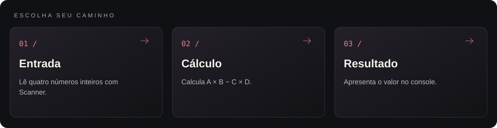
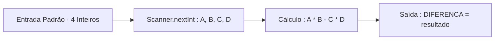

<p align="center">
  
</p>

<p align="center">Exercício de entrada de dados e cálculo de diferença em Java.</p>

<p align="center"></p>

<p align="center"><a href="#visão-geral">Visão geral</a> &nbsp;·&nbsp; <a href="#recursos">Recursos</a> &nbsp;·&nbsp; <a href="#como-executar">Como executar</a></p>

---

<a id="explore-o-projeto"></a>




<table width="100%">
<tr><th align="left">Área</th><th align="left">O que você encontra</th><th align="left">Acesso direto</th></tr>
<tr><td><strong>Entrada</strong></td><td>Lê quatro números inteiros com Scanner.</td><td><a href="DifencaJava.Java">Abrir entrada →</a></td></tr>
<tr><td><strong>Cálculo</strong></td><td>Calcula A × B − C × D.</td><td><a href="DifencaJava.Java#L18">Abrir cálculo →</a></td></tr>
<tr><td><strong>Resultado</strong></td><td>Apresenta o valor no console.</td><td><a href="DifencaJava.Java#L20">Abrir resultado →</a></td></tr>
</table>

<a id="visão-geral"></a>


O programa exemplifica o fluxo essencial de entrada e saída em Java com a classe java.util.Scanner, precedência de operadores aritméticos e liberação adequada do recurso de leitura (sc.close()).

<a id="recursos"></a>


| Recurso | Como funciona |
|---|---|
| Leitura tipada no console | Captura quatro números inteiros sequenciais (positivos ou negativos) via sc.nextInt(). |
| Cálculo determinístico | Avalia a expressão (A * B - C * D) respeitando a precedência nativa da multiplicação sobre a subtração. |
| Saída padronizada | Exibe o resultado exatamente no formato DIFERENCA = <valor>, compatível com juízes online. |
| Gestão de recursos | Fecha o objeto Scanner ao término da leitura para evitar vazamento de descritores de entrada. |

<a id="tecnologias"></a>


- **Java Standard Edition (java.util.Scanner)** para leitura de fluxo de entrada e aritmética inteira.

<details>
<summary>Arquitetura</summary>



</details>

<details>
<summary>Estrutura do repositório</summary>

```text
JavaDiferenca/
├── assets/
│   └── banner-v2.png               Banner do projeto
├── DifencaJava.Java                Código-fonte da classe Main
└── README.md
```

</details>

<a id="como-executar"></a>


1. Clone o repositório:
   ```bash
   git clone https://github.com/arthurlynow098/JavaDiferenca.git
   cd JavaDiferenca
   ```
2. Como a classe pública declarada é Main, copie o arquivo para Main.java, compile e execute:
   ```bash
   cp DifencaJava.Java Main.java
   javac Main.java
   java Main
   ```
3. Digite quatro números inteiros (ex.: 5 6 7 8) para obter `O resultado é: -26`.

---

<p align="center">
  <a href="https://github.com/arthurlynow098">GitHub</a> &nbsp;·&nbsp;
  <a href="https://arthurentsev.vercel.app/">Portfólio</a> &nbsp;·&nbsp;
  <a href="https://www.linkedin.com/in/entsevarthur/">LinkedIn</a>
</p>
